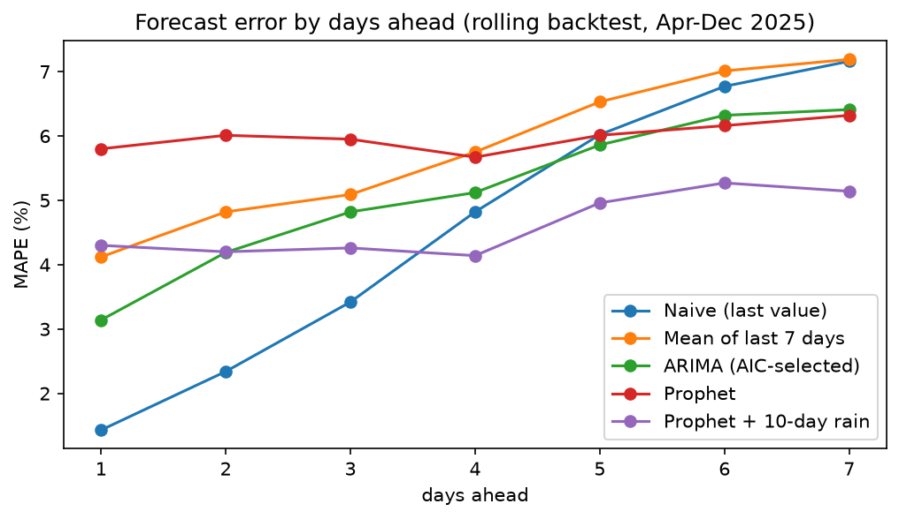
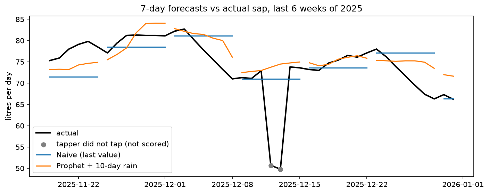

# Benchmark results: 7-day sap forecast

Generated by `uv run python -m kethaka_sap_cast.benchmark`.

## Overall (scored days only)

| model                 |   MAPE_% |   RMSE_L |   days_scored |
|:----------------------|---------:|---------:|--------------:|
| Naive (last value)    |     4.54 |     3.94 |           266 |
| Prophet + 10-day rain |     4.6  |     3.73 |           266 |
| ARIMA (AIC-selected)  |     5.11 |     4.4  |           266 |
| Mean of last 7 days   |     5.78 |     4.72 |           266 |
| Prophet               |     5.99 |     4.69 |           266 |

## MAPE % by days ahead

|   days_ahead |   Naive (last value) |   Mean of last 7 days |   ARIMA (AIC-selected) |   Prophet |   Prophet + 10-day rain |
|-------------:|---------------------:|----------------------:|-----------------------:|----------:|------------------------:|
|            1 |                 1.43 |                  4.12 |                   3.14 |      5.8  |                    4.3  |
|            2 |                 2.34 |                  4.82 |                   4.19 |      6.01 |                    4.2  |
|            3 |                 3.42 |                  5.09 |                   4.82 |      5.95 |                    4.26 |
|            4 |                 4.82 |                  5.75 |                   5.12 |      5.67 |                    4.14 |
|            5 |                 6.02 |                  6.53 |                   5.86 |      6.01 |                    4.96 |
|            6 |                 6.77 |                  7.01 |                   6.32 |      6.16 |                    5.27 |
|            7 |                 7.16 |                  7.19 |                   6.41 |      6.32 |                    5.14 |

## How to read this
- Rolling-origin backtest: train on all days before each cut-off, forecast the next 7 days,
  move forward 7 days (40 folds, Apr-Dec 2025). Jan-Mar is training data only.
- Days when a tapper was present but did not tap are forecast but not scored.
- MAPE = average % error. RMSE = typical error in litres, penalising large misses.
- Weather-based models use observed rainfall for future days (ex-post evaluation),
  so their results are an upper bound; in use, rain comes from a weather forecast.
